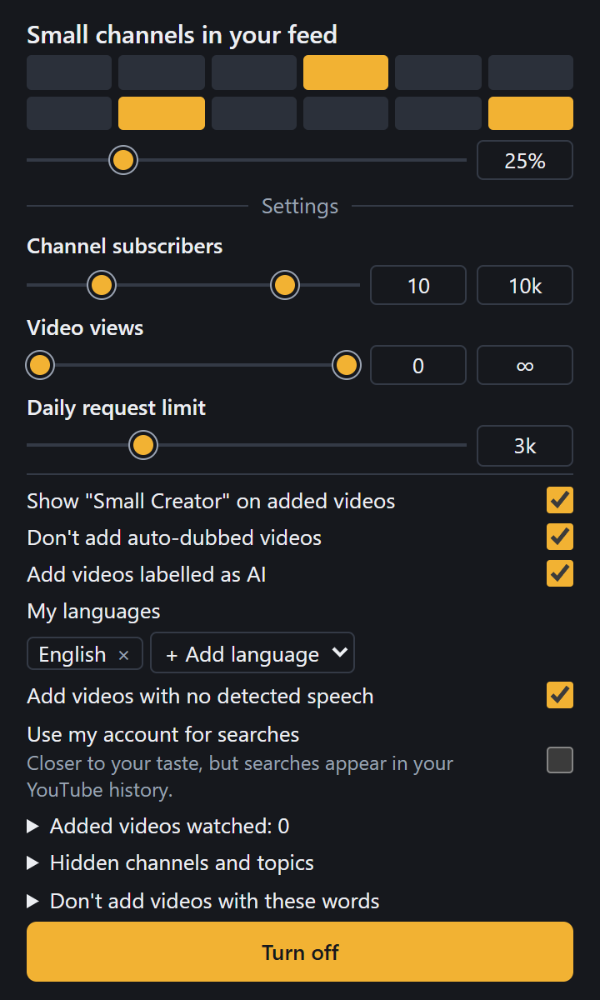

# Small-Youtube

YouTube promotes videos built for engagement, so original takes from small channels often go unseen. This browser extension adds videos from small channels next to what YouTube already recommends you, on the home feed and beside the video you're watching. The cards look exactly like YouTube's, and YouTube's own recommendations stay unless you set the share to 100%.

## Install

1. Download or clone this repository.
2. Open `chrome://extensions` and turn on Developer mode. Edge, Brave, Opera and Vivaldi have the same page.
3. Click **Load unpacked** and choose the `extension` folder.
4. Pin the extension if the welcome page asks you to.

For Firefox, run `npm install` and `npm run build:firefox`, then load `dist/firefox/manifest.json` at `about:debugging`.

## Settings

Click the extension's icon.

- **Small channels in your feed:** how much of your feed is small channels. The default is 25%.
- **Channel subscribers and video views:** what counts as small. The defaults are 10 to 10k subscribers and any number of views. Drag the handles, or type a value into the box.
- **Daily request limit:** how many requests the extension may make in a day. The default is 3k. A higher limit keeps cards coming for longer, but not faster.
- **Show "Small Creator" on added videos:** on by default. Added videos show this text after the date, so you can tell them from YouTube's own. It applies to new cards, so reload the page to see a change.
- **Don't add auto-dubbed videos:** on by default. The extension won't add videos YouTube would play with a robotic translation.
- **Add videos labelled as AI:** on by default. Turn it off and the extension won't add videos that carry YouTube's AI label. YouTube's own recommendations aren't affected.
- **My languages:** taken from your YouTube account once, or English plus your browser's language when you're logged out. The extension won't add videos in other languages.
- **Add videos with no detected speech:** on by default. These are mostly clips, animations and background noise, with no spoken language to check. Once in a while one may have speech that YouTube didn't caption.
- **Use my account for searches:** off by default. Picks may suit your taste better, but these searches appear in your YouTube history.
- **Added videos watched:** how many added videos you've opened, and which. It's saved only in your browser, and **Clear** empties it.
- **Don't add videos with these words:** type a word and press Enter. A video is skipped when its title contains that exact word, in any case, so "cat" won't catch "cats". Add each form you want to skip.

In a small card's ⋮ menu, **Hide this channel** and **Less of this topic** tune what you see. You can undo both in the settings.

## Good to know

- Small cards appear gradually as you scroll, so they may take a moment.
- Some picks will be off-topic. Use **Less of this topic** when that happens.
- When you're logged out and have no watch history, YouTube's home feed is empty, so cards only appear beside videos.
- At 100%, YouTube's cards stay on your first screen, because nothing swaps while you're looking at it.
- The AI setting only catches videos that carry YouTube's AI label, and creators choose whether to declare it.
- If YouTube pushes back, the extension pauses for 30 minutes and the popup says so. Your feed stays normal.

## Privacy

Everything stays in your browser, with no server and no analytics. The extension only talks to YouTube. It never reads your login details. To check languages and which audio YouTube would play, it loads normal YouTube pages using your account, which didn't appear in watch history in testing.

## Browsers

| Browser | Status |
|---|---|
| Chrome | Tested |
| Edge | Tested logged out |
| Brave, Opera, Vivaldi, Firefox | Untested, should work |
| Safari, mobile | Not supported |

## Contributing

See [AGENTS.md](AGENTS.md) for the project's rules, layout and tests.
